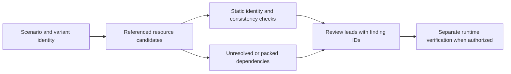

# Railroads: a developer's working guide

This guide explains the game and the local research tools for a mid-level
software developer. It uses original explanations, not reconstructed function
text. Treat it as a map of current understanding, not recovered design docs.
The [finding catalog](FINDINGS.md) and [validation record](VALIDATION.md) state
what the evidence supports. Update those records when understanding changes.

The writing pass used the [Caveman skill](https://github.com/JuliusBrussee/caveman/blob/2e08b9177c07bb7249a8a2d1a6758e5db281d002/skills/caveman/SKILL.md):
answer first, short sentences, exact technical terms, and no dropped qualifiers.
Its saved-document exception preserves normal prose. The skill was installed
locally at that revision; no proxy or model service was installed.

## Start with three layers

The native executable supplies behavior. Map and asset data supply content.
The launcher manages how the installed game and selected content are prepared.
A launcher fix, a valid XML file and a successful game session answer different
questions. None substitutes for the other two.

The installed Steam bundle contains a main x86_64 executable and several native
libraries. Two libraries also contain i386 slices. Each slice is a separate
analysis target, even when both slices share one container file. A library's
presence does not prove that the main process loads every slice or code path.
System libraries remain external dependencies of this research corpus.

An executable hash identifies exact bytes. A Mach-O UUID helps match a crash
image. Architecture identifies the instruction set and pointer layout. Use all
available identities before applying a build-specific address or finding.
Two observed i386 slices have no UUID; retain that gap rather than inventing one.

## Maps are connected data, not isolated XML files

A scenario refers to other resources, including industry, goods, train-car and
bridge definitions. The original auditors follow those references through loose
XML candidates. The relevant unit of investigation is the scenario plus its
dependencies and selected variant, not a filename alone.

Think of this as dependency resolution in a build system. A syntactically valid
file can still name a missing dependency, collide with another candidate or
describe an identity the runtime cannot use. Hashing only the scenario misses
changes in shared dependency files.

The native resource resolver is not fully modeled. Packed assets and ambiguous
loose-file candidates remain gaps. The broader auditor deliberately withholds
dependent projections when duplicate root XML reference fields make selection
unknown. This also applies when duplicate fields contain identical text.
See [SMR-K-002](FINDINGS.md#smr-k-002).

The audit's useful working model is:

This diagram describes the diagnostic workflow. It does not claim to reproduce
the game's complete loader or execution order.

## A concrete example: industry identities

The supported executable contains a fixed, 36-entry industry identity table.
The original reader accepts one exact executable hash and reads the table from
bounded, file-backed Mach-O segments. The private cross-check compares every
entry with Ghidra's independently imported references and strings.

For a synthetic example, suppose the registry includes `FactoryAlpha` and a map
defines `FactoryOmega`. The scanner reports the outside-table definition as a
static risk. It also distinguishes explicit placement from an unused definition.
Both names here are invented examples; no game table is distributed.

The result says the diagnostic's membership condition matched. It does not say
the game must crash. A definition may never be used, and an unrelated resource
can fail earlier. Conversely, membership does not validate animation data,
placement, loading, gameplay or saves. See [SMR-K-001](FINDINGS.md#smr-k-001).

The broader auditor also checks goods, cars, bridges, references and numeric
outliers. Some checks depend on inherited merge models or heuristics. Their
receipts retain partial evidence status under [SMR-K-003](FINDINGS.md#smr-k-003).
Do not promote all of them because one industry table was cross-checked.

## What the decompiled corpus gives us

Ghidra imports each native slice, discovers code and reconstructs pseudocode.
The exporter records functions, body ranges, static references, direct call
edges, identified strings and references to those strings. Each function keeps
its success or failure status and output digest.

Pseudocode is a reconstruction. Function boundaries, inferred types and names
can be incomplete or wrong. Indirect calls can hide relationships from a static
call graph. Data and undiscovered code do not become understood because an
export finished. Failed functions remain visible in the coverage record.

A fresh import can produce different labels and row order. Our cold main
replay reproduced the tested searches and map audits. All 79,340 reconstructed
implementation files matched byte for byte; five external declaration labels
and reference row order varied. External declaration comments contain no
implementation. Match build identity, static address and body digest where
available when comparing imports. Keep the accepted corpus as the reference;
do not treat reconstructed labels as stable source declarations.
[Validation](VALIDATION.md#pr-and-main-replay) records the exact limits.

The SQLite index makes this evidence reusable. A local query can locate a
function by name or containing address, inspect references, or search strings.
Results go to a private file with bounded rows and optional bounded code.
Cloud sessions receive reviewed original notes and operational counts. They
do not read raw pseudocode or extracted strings through the tool response.

Bulk export uses persistent Ghidra projects. REA remains useful for targeted
gaps. REA's saved snapshot is not automatically a cache hit; the installed
6.4.0 CLI and document-bound API behaved differently in the synthetic test.
See the measured cache evidence in [VALIDATION.md](VALIDATION.md).

## How to investigate a crash

Begin with the actual exception and faulting thread. Bind the image UUID,
architecture and available executable hash to a corpus module. Preserve the raw
report locally. A familiar module name alone is insufficient.

Keep runtime addresses separate from static addresses. For a known image base,
the image-relative offset is the runtime program counter minus the loaded base.
Map that offset into the matching static image before looking up a function.
Do not subtract arbitrary addresses across different images or architectures.
Translated Rosetta frames can require additional mapping; leave unsupported
frames unresolved. The lookup CLI expects a static address, not a runtime PC.

Then inspect a bounded neighborhood locally and consult the subsystem findings.
Ask which input could produce the observed condition and which check could
disprove the hypothesis. A loading-related frame does not identify the faulty
map resource by itself. Record competing explanations and missing evidence.
The existing crash parsers remain the starting point for report parsing; this
slice adds no automatic diagnosis, upload expansion or crash repair.

## How to use this when building or debugging

Start engine-dependent work with [KNOWLEDGE_USE.md](KNOWLEDGE_USE.md), the current
validation record and the relevant finding IDs. Match the target before using
a build-specific rule. Make one targeted private lookup rather than reading
the entire corpus.

Specify a counterexample before changing a rule. For example, a membership
diagnostic needs a registered synthetic identity, an outside identity, an
ambiguous dependency and an unsupported executable. The expected results come
from the diagnostic contract, not from copying its implementation into a test.

Record the catalog digest, applied rules, evidence matches and gaps. Auditors
with `--corpus-root` check the binding mechanically; without it they explicitly
report unavailable private evidence. Unknown rule references fail rather than
silently disappearing from the report.

Static tests validate the tool's assumptions and behavior. A game loading a map,
saving it, reopening the save and continuing play are separate observations.
This project has not performed those runtime checks. A clean static report is
useful evidence about implemented checks, not a compatibility certificate.

## Where to go next

Use [CORPUS.md](CORPUS.md) for commands, storage, replay and precise limits.
Use [FINDINGS.md](FINDINGS.md) for rules and certainty. Use
[VALIDATION.md](VALIDATION.md) for actual coverage and comparisons. Preserve new
original explanations with stable IDs so the next session can build on them.
Extend the guide one evidenced subsystem at a time; rendering, simulation,
economy, pathfinding and complete save semantics remain future research.
